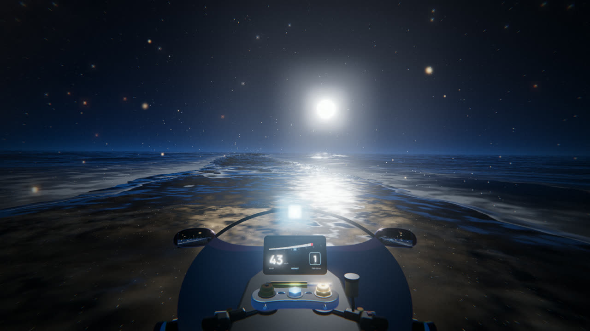

# Tidelight

An endless night ride between two seas. A relaxing first-person motorbike ride along a sand road under a starry sky, with the ocean on both sides washing over the track. No obstacles, no crashes: just follow the road until dawn.



## Play

It's a single page. Serve the folder so the sounds can load:

```bash
python -m http.server 8765
```

Then open http://localhost:8765.

## Controls

| Key | Action |
| --- | --- |
| ↑ ↓ | Speed (up to 275 km/h) |
| ← → | Steer |
| 1 2 3 | Theme: Moonlit, Dusk dream, Bioluminescent |
| P | Photo mode (drag to look around, Enter saves) |
| M | Sound on/off |
| Esc | Menu |

A gamepad works (stick to steer, triggers for speed). On phones, tap the left or right side to steer, or turn on tilt steering in the menu.

## Built with

- [three.js](https://threejs.org) 0.160, loaded from a CDN
- Sound effects generated with [ElevenLabs](https://elevenlabs.io); the music pad and chimes are synthesized in the browser
